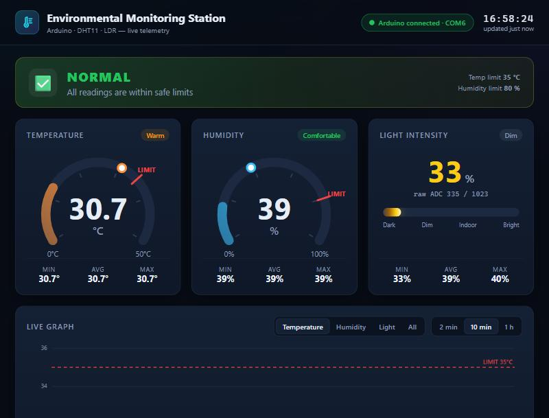
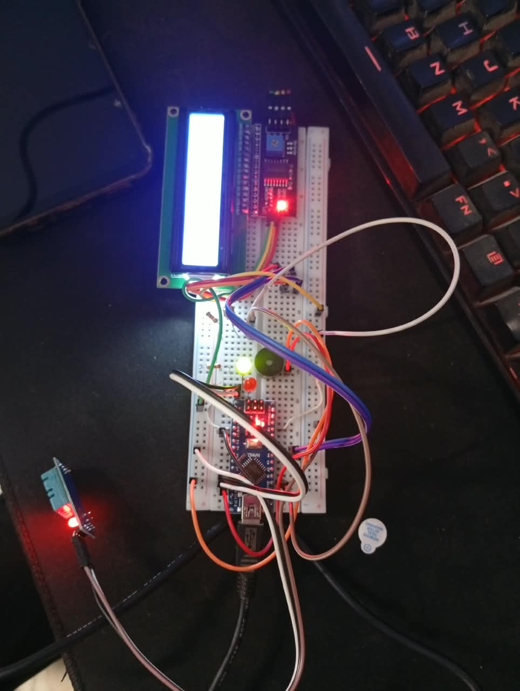
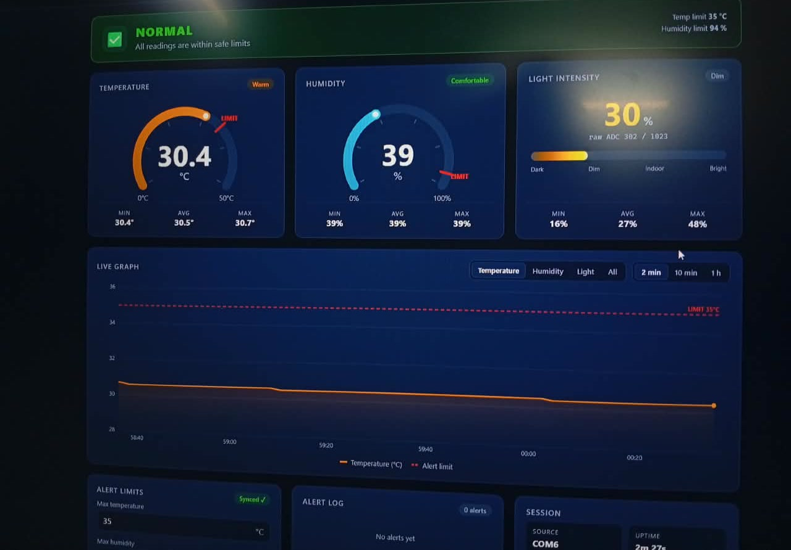
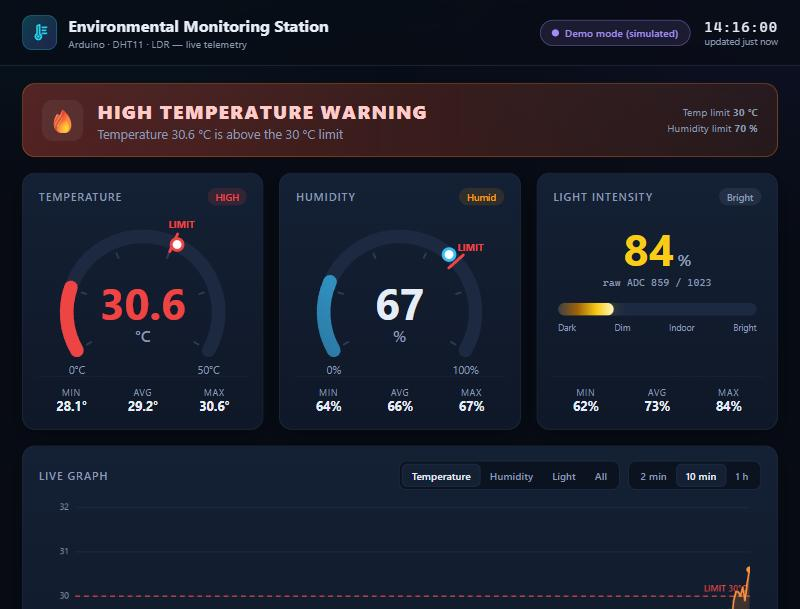

# Smart Environmental Monitoring Station

An Arduino Nano reads **temperature, humidity (DHT11)** and **light (LDR)**. A laptop
shows the readings on a **live web dashboard** with gauges, a live graph, a NORMAL / HIGH
TEMPERATURE status banner and an alert log. When a reading goes over its limit,
the red LED, the buzzer and the LCD all react. You can **change the alert limits from the
browser**, and the new limits are sent back to the Arduino over USB.



| The hardware | Running on the laptop |
|---|---|
|  |  |

**Demo video:** [docs/demo.mp4](docs/demo.mp4) (18 s: the live dashboard, then the hardware and LCD)

| Normal | Alert |
|---|---|
|  |  |

### How it works

```
 DHT11 ─┐                       USB serial (9600 baud)                 Browser / phone
 LDR  ──┼─► Arduino Nano  ◄────────────────────────────►  Python server  ◄── HTTP + SSE ──►  Dashboard
 LEDs ◄─┤   (sketch)          DATA,28.4,61.0,702,NORMAL   (server.py)       live push       (HTML/JS)
 Buzzer◄┤                     LIMITS,35.0,80.0  ◄──────                       ──► CSV logs
 LCD  ◄─┘
```

- **Arduino (C++)**: reads the sensors every 2 s, drives the LEDs, buzzer and I2C LCD,
  and listens for limit and mute commands from the laptop. Non-blocking loop, with
  alert hysteresis so sensor jitter can't make the alarm flicker.
- **Server (Python, standard library + pyserial)**: auto-detects the board, reconnects if
  it's unplugged, logs to CSV, and pushes every reading to all open browsers with
  Server-Sent Events. It also serves a small JSON API.
- **Dashboard (vanilla HTML/CSS/JS)**: SVG gauges, a hand-drawn canvas chart with hover
  tooltips, and a responsive layout that works on phones. It has no external dependencies,
  so it **works offline**.
- **Demo mode** (`--demo`) simulates the sensors, so the dashboard runs without any hardware.

### API

| Endpoint | Description |
|---|---|
| `GET /api/state` | Latest reading, connection, limits, stats, alert log |
| `GET /api/history?seconds=600` | Readings from the last N seconds |
| `GET /api/stream` | Server-Sent Events: `reading`, `alert`, `connection`, `config` |
| `GET /api/export.csv` | All readings this session as CSV |
| `POST /api/limits` | `{"temp_limit": 35, "hum_limit": 80}`, also sent to the Arduino |
| `POST /api/mute` | `{"muted": true}`, mutes the Arduino buzzer |

```
Env-Monitor-Station/
├── arduino/env_monitor/env_monitor.ino   ← upload this to the Arduino
├── server/server.py                      ← laptop server (reads USB, serves dashboard)
├── server/static/                        ← the dashboard web page
├── start.bat                             ← double-click to run with the Arduino
└── demo.bat                              ← double-click to run with fake data (no Arduino)
```

---

## 1. Wiring

| Part | Part pin | Arduino pin |
|---|---|---|
| DHT11 module | VCC (+) | 5V |
| | DATA (OUT / S) | **D2** |
| | GND (−) | GND |
| LDR | one leg | 5V |
| | other leg | **A0** |
| 10kΩ resistor | between A0 and GND | — |
| Green LED | long leg (+) via 220Ω | **D8** |
| Red LED | long leg (+) via 220Ω | **D9** |
| LED short legs (−) | | GND |
| Active buzzer | + | **D10** |
| | − | GND |
| I2C LCD (optional) | VCC / GND | 5V / GND |
| | SDA | **A4** |
| | SCL | **A5** |

```
5V ──── LDR ────┬──── A0
                │
              10kΩ
                │
GND ────────────┘
```

### Using an Arduino Nano

Use a classic **Nano (ATmega328P)** with soldered headers. Don't use a Nano 33, Nano ESP32 or
Nano RP2040, because those run on 3.3 V. The pins are the same as the Uno, so the code doesn't change.

With the **USB port on the left**, the Nano's pins are:

```
          D13 3V3 REF A0  A1  A2  A3  A4  A5  A6  A7  5V  RST GND VIN
 ┌─────┐ ┌──────────────────────────────────────────────────────────┐
 │ USB │ │                    ARDUINO NANO                          │
 └─────┘ └──────────────────────────────────────────────────────────┘
          D12 D11 D10 D9  D8  D7  D6  D5  D4  D3  D2  GND RST RX0 TX1
```

Push it into the breadboard so it straddles the centre gap, in columns 1–15. Put the other parts
at column 20 onwards, and use only the top + / − rails.

| # | Wire | From | To |
|---|---|---|---|
| 1 | M-M | Nano 5V (col 12, top) | + rail |
| 2 | M-M | Nano GND (col 14, top) | − rail |
| 3 | M-M | + rail | col 20 (DHT11 +) |
| 4 | M-M | col 21 (DHT11 DATA) | Nano D2 (col 11, bottom) |
| 5 | M-M | col 22 (DHT11 −) | − rail |
| 6 | M-M | + rail | col 26 (LDR) |
| 7 | M-M | col 29 (LDR + 10kΩ, other end of 10kΩ in − rail) | Nano A0 (col 4, top) |
| 8 | M-M | Nano D8 (col 5, bottom) | col 34 (green LED long leg; short leg col 35 → 220Ω → − rail) |
| 9 | M-M | Nano D9 (col 4, bottom) | col 39 (red LED long leg; short leg col 40 → 220Ω → − rail) |
| 10 | M-M | Nano D10 (col 3, bottom) | col 45 (buzzer +) |
| 11 | M-M | col 47 (buzzer −) | − rail |
| 12–15 | M-F | LCD GND / VCC / SDA / SCL | − rail / + rail / A4 (col 8, top) / A5 (col 9, top) |

Upload settings: **Board → Arduino Nano**, **Processor → ATmega328P (Old Bootloader)**.
If no COM port appears, install the **CH340 driver** and try another USB cable.

---

## 2. Upload the Arduino code

1. Install the **Arduino IDE** (arduino.cc/en/software).
2. **Tools → Manage Libraries**, then install:
   - `DHT sensor library` by Adafruit (click *Install all* when it asks about dependencies)
   - `LiquidCrystal I2C` by Frank de Brabander
3. Open `arduino/env_monitor/env_monitor.ino`.
4. **Tools → Board**: Arduino Uno (or Arduino Nano).
   *Nano clone fails to upload?* Try **Tools → Processor → ATmega328P (Old Bootloader)**.
5. **Tools → Port**: pick the COM port that appears when you plug the board in.
6. Click **Upload** (→).

On start-up the LEDs flash and the buzzer chirps once (self-test).
**No LCD?** Change `#define USE_LCD 1` to `0` at the top of the sketch.

Quick check: open **Tools → Serial Monitor** at 9600 baud. You should see lines like
`DATA,28.4,61.0,702,NORMAL` every 2 seconds. **Close the Serial Monitor
afterwards**, because only one program can use the USB port at a time.

---

## 3. Run the dashboard

You need **Python 3.10 or newer** (python.org). During install, tick **"Add python.exe to PATH"**.

- **With the Arduino:** plug it in, double-click **`start.bat`**
- **Without the Arduino (testing or backup demo):** double-click **`demo.bat`**

The first run takes about 30 s to set up. After that the browser opens
**http://localhost:8000** by itself.

The console window also prints a **Network** address, for example `http://192.168.1.23:8000`.
Phones on the **same Wi-Fi** can open that address to see the dashboard live.
If Windows Firewall asks, click **Allow** for private networks.

Command-line options (`python server/server.py …`):

| Option | What it does |
|---|---|
| `--port COM5` | Use this serial port instead of auto-detecting |
| `--demo` | Fake sensor data, no Arduino needed |
| `--http-port 8080` | Run the website on another port |
| `--host 127.0.0.1` | Only this laptop can open the dashboard |

---

## 4. Dashboard features

- **Status banner**: green **NORMAL**, or red **HIGH TEMPERATURE / HIGH HUMIDITY WARNING**
- **Gauges** for temperature and humidity with a red limit marker, plus min / avg / max
- **Light meter** (0–100 % and the raw 0–1023 reading)
- **Live graph**: temperature, humidity, light or all three, over 2 min / 10 min / 1 h.
  Hover over it to see exact values.
- **Alert limits**: change the max temperature or humidity from the browser. The new limit is
  **sent to the Arduino**, and the LEDs and buzzer follow it. "Synced ✓" means the Arduino confirmed it.
- **Mute buzzer** switch, plus an optional beep from the laptop
- **Alert log** with times
- **Arduino connection status** (connected / searching / disconnected / sensor error)
- **Download CSV**. Every reading is also saved automatically in `server/logs/`.

Alerts have a small dead-band. Once an alert is on, it only clears when the reading drops
0.5 °C (or 2 % humidity) below the limit, so sensor jitter can't make it flicker.

---

## 5. Presentation tips

- **Trigger a temperature alert:** pinch the DHT11 between your fingers or breathe on it slowly.
  The fastest way is to lower the temperature limit in the dashboard to just below the
  current reading and click *Apply to Arduino*. The red LED, buzzer and red banner all go off together.
- **Trigger a humidity alert:** breathe on the DHT11. Humidity jumps within a few seconds.
- **Show the light sensor:** cover the LDR with your hand, then shine a phone torch on it.
- **Backup plan:** if anything goes wrong with the hardware on the day, run `demo.bat`.
  It shows simulated data with an occasional heat spike.

---

## 6. Troubleshooting

| Problem | Fix |
|---|---|
| Dashboard says **"Searching for Arduino"** | Check the USB cable is a *data* cable. If the board uses a CH340 chip, install the CH340 driver. Or start with `--port COMx` (find the port in Arduino IDE → Tools → Port). |
| **"Port busy - close the Arduino IDE Serial Monitor"** | Close the Serial Monitor or Serial Plotter in the Arduino IDE. |
| **"Sensor error"** / LCD says *DHT11 error* | Check the DHT11 DATA wire is on **D2** and that it has 5V and GND. A bare 4-pin DHT11 needs a 10kΩ resistor from DATA to 5V. |
| Light always 0 or always 100 % | The LDR and 10kΩ divider is wired wrong. Check the drawing above. |
| LCD is lit but shows nothing | Turn the blue contrast screw on the back. Still blank: change `LCD_ADDRESS` to `0x3F`. |
| Readings look wrong in the browser | Press Ctrl+F5 to reload the page. |
| `start.bat` closes instantly | Python isn't on PATH. Reinstall Python and tick "Add python.exe to PATH". |
